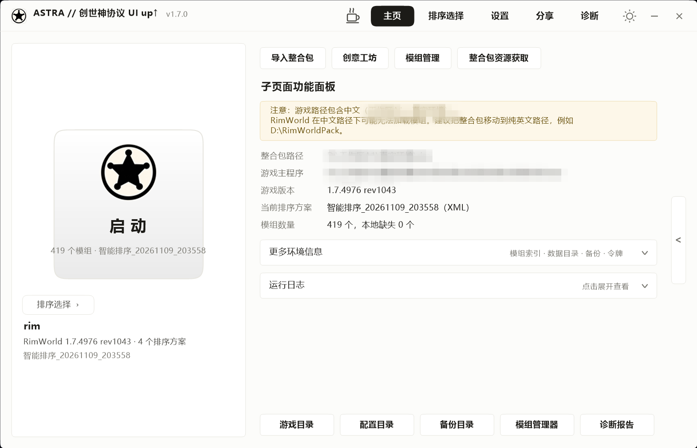
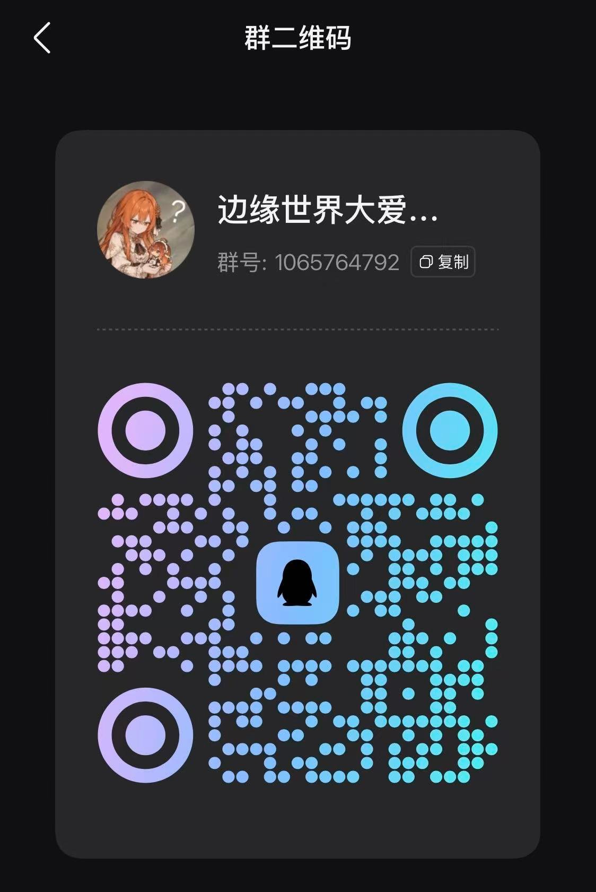

# Astra 创世神协议 · UI Up↑ UI升级版 极简

RimWorld（边缘世界）**整合包一键启动器**。把「装模组管理器 → 设路径 → 导入排序 → 保存 → 启动游戏」这一整套手工流程压成一个按钮。

本仓库是**极简风 UI 重写版**：界面全部自绘，零第三方依赖，用 Windows 自带的 `csc.exe` 手工编译，产物是单个 exe。



---

## 它替你做什么

1. 把玩家原有 `Config` 备份到整合包目录下 `ZOGOS备份\`（默认保留 10 份，可调）
2. 用整合包自带的 `Config` 覆盖
3. 写入选中的模组排序（`ModsConfig.xml`）
4. 启动 `RimWorldWin64.exe`

只动 `Config`，**不碰存档、不碰模组文件**；备份失败会直接中止，绝不动配置。

## 功能一览

| 模块 | 说明 |
|---|---|
| 排序方案 | 启动器自动扫描 `排序文件\` 下的 xml / json，json 会自动转成游戏可读格式；带「含 RJW」标记会显式提示 |
| 整合包导入导出 | 按 ZOGOS 包格式打 zip（含识别令牌），支持完整包/轻量包；导入时校验令牌并自动绑定 |
| 创意工坊 | Steam Web API 搜索（有 Key 走官方接口，无 Key 降级网页抓取）→ `steam://` 唤起下载 → 轮询工坊目录 → 复制进整合包 `Mods\`；支持合集展开 |
| 工坊同步 | 扫工坊内容目录与 `Mods\` 两侧，按 `packageId` / `PublishedFileId.txt` 对账，产出同步计划再执行 |
| 模组体检 | 18 条检查规则（缺依赖、版本不符、排序冲突…），可一键生成安全排序 |
| 依赖图 | 模组网状依赖关系，找环、找缺失 |
| 在线资源表 | 远程整合包资源列表 + 下载入口 |
| 苏苏 AI | 内嵌自绘覆盖层（立绘 + 气泡 + 打字机 + 语音），可切回旧悬浮窗 |
| 诊断 | 生成 txt 诊断报告、PDF 报告、手机版整合包导出（需 ffmpeg） |
| 外观 | 深色/浅色一键切换、界面缩放 100~200%、右栏折叠、圆角分层窗口 |

## 技术栈与硬约束

- **C# 5**（.NET Framework 4.x 自带的 `csc.exe`），**禁止**字符串插值 `$""`、`?.`、`nameof`、表达式体成员
- **WinForms + GDI+ 全自绘**：窗口是 `WS_EX_LAYERED` 分层窗口，用 `UpdateLayeredWindow` 直推 32bpp 位图；**不能放任何 Win32 真控件**，所有元素都是自绘 `El`，鼠标事件由主窗统一命中分发
- **零第三方依赖**：网络用 `HttpWebRequest`，JSON 用 `JavaScriptSerializer`，压缩用 `System.IO.Compression`
- 逻辑坐标固定 `1010×650`，渲染时按 `UiScale`（默认 130%）等比放大
- 不引入工程文件：编译清单在 `src/build_gui.rsp`

## 目录结构

```
Astra创世神协议-UIUp-UI升级版-极简/
├─ src/                 源码（编译清单 build_gui.rsp 在这里）
│  ├─ Program.cs        入口 + 命令行参数（--root/--shot/--smoke/--susu/--appdata）
│  ├─ MainForm.cs       主窗体（五页：主页/排序/设置/分享/诊断）
│  ├─ MinControls.cs    分层窗口基类 LayeredForm + 全部自绘控件 El*
│  ├─ MinTheme.cs       色彩/字号令牌（T.*，深浅色都从这里取）
│  ├─ MinDialog.cs      自绘弹窗（MinMsg.Show，已全局替换 MessageBox）
│  ├─ Min*.cs           各页与覆盖层（Sort/Settings/Share/Feed/Graph/Workshop/Susu）
│  ├─ Core*.cs          路径识别/设置/排序/部署/备份
│  ├─ ModAnalyzer.cs    体检规则  ModGraph*.cs 依赖图
│  ├─ Workshop*.cs      工坊搜索/同步  Pack*.cs 包管理/分发
│  ├─ Susu*.cs          苏苏对话/语音  AiClient.cs AI 接入
│  ├─ Setup.cs          安装向导（独立打包目标）
│  ├─ voice/            苏苏配音 wav（嵌入资源）
│  └─ *.png/*.jpg       界面资源（logo、立绘、二维码、背景）
├─ docs/                授权记录（含原作者同意截图）与成品截图
├─ .github/             issue 模板（缺陷 / 功能建议）
├─ dist/                已编译成品（不进 git）
├─ 构建说明.md           编译、自检、产物一致性校验
├─ CONTRIBUTING.md      提 PR 的硬约束（C# 5、零依赖、必跑自检）
├─ SECURITY.md          漏洞私密报告渠道与范围
├─ CHANGELOG.md         版本变更记录
├─ LICENSE              MIT
└─ PULL_REQUEST_TEMPLATE.md
```

## 快速构建

```bat
cd src
:: exe 被占用时必须先关掉
taskkill /IM "Astra创世神协议UI Up.exe" /F
"C:\Windows\Microsoft.NET\Framework64\v4.0.30319\csc.exe" /nologo /codepage:65001 ^
  /target:winexe /main:Zogos.Program /win32icon:"app.ico" ^
  /out:"..\dist\Astra创世神协议UI Up.exe" @build_gui.rsp
```

细节、自检截图、打包安装包的方式见 [构建说明.md](构建说明.md)。

## 运行要求

- Windows 10 / 11（`.NET Framework 4.x` 系统自带）
- 创意工坊功能需要 Steam 客户端已登录；搜索若不配 Steam API Key 则依赖网页访问
- 手机版导出/视频背景需要 `ffmpeg.exe`（**未随仓库分发**，自行放到 `src/tools/`）

## 反馈与贡献

| 类型 | 去哪 |
|---|---|
| **缺陷**（闪退/报错/界面错位） | [新建 Issue](../../issues/new/choose) → 选「缺陷报告」，模板会提示要附哪些日志 |
| **功能建议** | 同上，选「功能建议」 |
| **使用问题 / 想直接问** | QQ 群 **1065764792** · 边缘世界大爱盟『镇魔天堡』<br> |
| **安全漏洞** | **不要开公开 issue**，按 [SECURITY.md](SECURITY.md) 走私密渠道 |
| **改代码** | 先看 [CONTRIBUTING.md](CONTRIBUTING.md) 的硬约束，再提 PR |

个人项目，响应时间不保证；带了完整日志 + 复现步骤的问题会优先处理。

## 版权与开源状态

**本项目以 [MIT 许可证](LICENSE) 发布。**

- 原始代码作者：**ZOGOS**（QQ 昵称「正魔天堡之主」，授权记录见 [docs/授权记录.md](docs/授权记录.md)，含群聊截图）
- 极简 UI 重写：**A1**
- 素材库（立绘、配音、群二维码等）按作者说明随代码同属 MIT
- 仓库中不包含 `ffmpeg.exe` 等第三方二进制，需要时自行放到 `src/tools/`

Copyright (c) 2026 ZOGOS, A1

## 致谢

- ZOGOS：原版启动器的业务逻辑与 RimWorld 整合包管理方案
- RimSort / RimWorld 社区：排序与模组元数据格式参考
